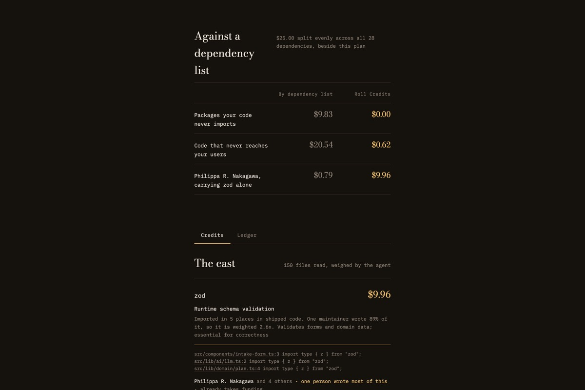
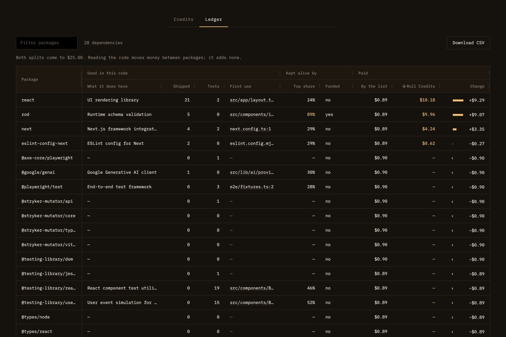

# Roll Credits

> Every film ends with credits. Your software doesn't.

Roll Credits reads a codebase, works out which people it really depends on, and pays them through PayPal — ending on
a film-credits roll where each name lights up as PayPal confirms the money arrived.

**Live demo: https://roll-credits-desilva23s-projects.vercel.app** — no sign-in, no setup.

- **[Read an example repository](https://roll-credits-desilva23s-projects.vercel.app/?repo=desilva23/celebration-planner)**
  — opens straight into a reading.
- **[Watch a real run](https://roll-credits-desilva23s-projects.vercel.app/?replay)** — the credits roll for a real
  sandbox payout, with every state read live from PayPal. No PayPal login needed.

Built for the PayPal AI Hackathon 2026.


---

## The problem

Every project runs on code written by people its authors have never met, and most of those people are paid nothing
for it. The obvious fix — split money across your dependency list — sends it to the wrong places. On the author's own
app, the package imported most often was the **test runner**: 64 imports, none of them in code that ships to users.
Splitting by imports would have paid it most.

Roll Credits reads what the code actually does instead. On the same app, for a $25 budget:



## How it works

1. **Read the code.** Fetches the repository's `package.json`, then reads up to 150 of its own source files and finds
   every place each dependency is actually imported, recording a file and line. A package nobody imports earns
   nothing. Product code and test code are counted separately.
2. **Weigh it.** A measured score from how often and where each package is used, on a log scale so twenty imports
   don't count four times as much as five.
3. **Find the people.** Follows each package to its GitHub repository and reads who really commits there, dropping
   bots, and notes whether one person is carrying it and whether the project already takes funding.
4. **Favour whoever is alone.** A package is lifted by up to 3× as its maintenance concentrates on one person. This
   is the whole argument: reach the people nobody else is paying. On the example repo, before the agent adjusts
   anything, this step alone moves one-person projects from 16% to 46% of the budget.
5. **Ask the agent.** An LLM reads the real import sites and argues how load-bearing each package is _in this
   codebase_, not by reputation. It can scale a weight between a half and double, and can set no amount at all. If
   the larger model is at its rate limit, a smaller one answers; if neither can, measurement alone decides and the
   screen says so. A judgement is remembered for a week, so the same code reads the same way twice.
6. **Split it.** Integer cents, largest remainder, always summing to exactly the amount captured. One person is paid
   once however many packages they maintain.
7. **Pay them.** A PayPal order is captured, then a Payouts batch goes out and the credits roll, each name brightening
   as PayPal reports `SUCCESS`.

The same reading has two views. **Credits** makes the argument, and every evidence line links to that line on
GitHub. **Ledger**, built with AG Grid, is the table behind it, for whoever has to defend the spend: sort by what was
paid, by who is carrying a project alone, or by who already has funding; filter to one package; follow each
package's first use to its exact line of code; see what reading the code moved against splitting the list; and
download it all as CSV. Its total row shows both splits coming to the same budget, so the money rule is visible
rather than claimed.



## Use it from a coding agent

Coding agents install open-source packages all day and never see a sponsor button. Roll Credits is also an
[MCP](https://modelcontextprotocol.io) server, so an agent can ask who a project depends on and open a payment for
them. To add it to Claude Code:

```bash
claude mcp add --transport http roll-credits https://roll-credits-desilva23s-projects.vercel.app/api/mcp
```

Then ask, in the project you are working on: _"Who should this project credit?"_ or _"Credit the maintainers this
project depends on with $10."_

| Tool                 | Does                                                                                                 | Moves money?                              |
| -------------------- | ---------------------------------------------------------------------------------------------------- | ----------------------------------------- |
| `who_to_credit`      | Reads the repository and reports who it depends on, with evidence and the dependency-list comparison | No                                        |
| `credit_maintainers` | Opens a PayPal payment and returns an approval link                                                  | Only after a person approves it in PayPal |

The agent proposes; a person approves; code decides every amount. After approval PayPal returns to Roll Credits,
which sends the payouts and rolls the credits. The server is stateless JSON over Streamable HTTP, tested with the
official MCP client SDK. See [`src/app/api/mcp/route.ts`](src/app/api/mcp/route.ts).

## What is real, and what is not

|              |                                                                                                                     |
| ------------ | ------------------------------------------------------------------------------------------------------------------- |
| **Real**     | Every PayPal call. Orders, capture, Payouts, signature-verified webhooks — all against the PayPal **sandbox**       |
| **Real**     | The code reading. Live GitHub and npm data, no fixtures                                                             |
| **Real**     | The AI judgements. Groq, made when a codebase is first read and remembered for a week                               |
| **Not real** | The money. Sandbox only. The app refuses to talk to live PayPal — the base URL is hard-coded                        |
| **Not real** | The names. Every maintainer appears under a generated film-credit name                                              |
| **Not real** | The recipients. One sandbox test address can receive; all others resolve to `example.com` and come back `UNCLAIMED` |

### Why nobody is named

The hackathon rules make an entrant warrant that nothing published breaches anyone's privacy or publicity rights.
Publishing real, identifiable maintainers alongside an AI's opinion of how they are funded sits squarely inside that.
So every contributor is shown under a film-credit name made from their GitHub login with a keyed hash, HMAC-SHA256.
The login and the key both stay on the server. A plain hash would not be enough: anyone with a project's public
contributor list could hash every login and match the names back. Without the key, they cannot.

What a generated name cannot hide is what is public already. The one person who wrote nearly all of a well-known
package can be looked up from the package. Roll Credits does not name them, and does not pretend that makes them
unknowable. No real maintainer was contacted, named or paid.

## Built with

|             |                                                                                                                                                                                                                                                                                                                                                                        |
| ----------- | ---------------------------------------------------------------------------------------------------------------------------------------------------------------------------------------------------------------------------------------------------------------------------------------------------------------------------------------------------------------------- |
| **PayPal**  | JS SDK v6 (`createPayPalOneTimePaymentSession`), Orders v2, Payouts, webhooks with signature verification                                                                                                                                                                                                                                                              |
| **AI**      | Groq — `openai/gpt-oss-120b`, falling back to `openai/gpt-oss-20b` when the larger is at its rate limit, with strict JSON-schema output. Judgements are cached for a week                                                                                                                                                                                              |
| **AG Grid** | AG Grid Community (MIT) for the ledger: grouped columns, a pinned total row, quick filter, custom cell renderers for the change bars and the links to code, and CSV export, themed with the Theming API so it wears the page's own colours — [`src/components/LedgerGrid.tsx`](src/components/LedgerGrid.tsx), [`LedgerColumns.tsx`](src/components/LedgerColumns.tsx) |
| **MCP**     | A Model Context Protocol server, so coding agents can credit the people a project depends on — [`src/app/api/mcp/route.ts`](src/app/api/mcp/route.ts)                                                                                                                                                                                                                  |
| **Stack**   | Next.js App Router, TypeScript in strict mode, Zod, Vitest, deployed on Vercel                                                                                                                                                                                                                                                                                         |

## Where the money decisions live

The model argues about importance. It never sees or sets an amount.

| Decision                                         | Made by                                                                                                                                       |
| ------------------------------------------------ | --------------------------------------------------------------------------------------------------------------------------------------------- |
| What a package does here, how load-bearing it is | The agent — [`src/lib/ai/attribute.ts`](src/lib/ai/attribute.ts)                                                                              |
| How far the agent may move a weight              | Clamped, 0.5×–2× — [`src/lib/ai/contract.ts`](src/lib/ai/contract.ts)                                                                         |
| Every amount, in integer cents                   | Code alone — [`src/lib/domain/split.ts`](src/lib/domain/split.ts)                                                                             |
| Whether money moves at all                       | The server, after PayPal confirms the capture — [`src/app/api/payouts/route.ts`](src/app/api/payouts/route.ts)                                |
| Which repository's maintainers are paid          | Sealed into the PayPal order when it is created, read back from PayPal before paying — [`src/lib/server/orders.ts`](src/lib/server/orders.ts) |

Rules the code holds to, each with tests:

- Payouts always sum to exactly the amount PayPal captured.
- No payout before the capture is verified server-side, with PayPal as the source of the amount.
- One payout batch id per order, so a retried request is refused by PayPal rather than paying twice.
- No amount ever comes from the browser or the model, and neither does the choice of who is paid: the browser
  sends an order id, and the amount and repository are read back from PayPal.
- Webhooks are rejected unless their signature verifies against the raw request bytes.
- The app cannot reach live PayPal.

## Running it yourself

Needs Node 22 or newer.

```bash
npm install
cp .env.example .env.local   # fill in your own sandbox values
npm run dev
```

Create a **United States** sandbox business account and a sandbox personal account at
[developer.paypal.com](https://developer.paypal.com/), make an app against the business account with **Payouts**
enabled, and copy its client ID and secret into `.env.local`.

**It works without an AI key.** With `GROQ_API_KEY` unset, the agent is skipped and the measured weighting decides on
its own — the whole flow still runs end to end.

```bash
npm run check   # formatting, linting, types and tests
```

## Evaluation

| Criterion                        | How it is addressed                                                                                                                                                                    | Where to look                                                                                                                      |
| -------------------------------- | -------------------------------------------------------------------------------------------------------------------------------------------------------------------------------------- | ---------------------------------------------------------------------------------------------------------------------------------- |
| **Technological implementation** | Four PayPal surfaces working together — JS SDK v6, Orders, Payouts and signature-verified webhooks, an agent reading real code under a clamped contract, and money rules held by tests | [`src/lib/server/`](src/lib/server/), [`src/lib/ai/`](src/lib/ai/), [`src/lib/domain/split.test.ts`](src/lib/domain/split.test.ts) |
| **Design**                       | A complete path from a pasted URL to money arriving. Two deliberate worlds: a monospaced cutting room, and cinema. The AG Grid ledger is themed to match, not left as a default grid   | [`src/app/globals.css`](src/app/globals.css), [`src/components/LedgerGrid.tsx`](src/components/LedgerGrid.tsx)                     |
| **Potential impact**             | Measured on a real repository, not asserted. The naive split's largest payee was the test runner; this one's is a maintainer working alone                                             | [`src/lib/domain/weight.ts`](src/lib/domain/weight.ts)                                                                             |
| **Innovation**                   | Pays by what the code calls, not what it lists. Favours whoever is unsupported. Names nobody without consent. Coding agents can credit what they install, with a person approving      | [`src/lib/domain/stage-name.ts`](src/lib/domain/stage-name.ts)                                                                     |
| **Presentation**                 | The demo ends on names lighting up as PayPal confirms each payment                                                                                                                     | [`src/components/CreditsRoll.tsx`](src/components/CreditsRoll.tsx)                                                                 |

359 tests. The domain logic — everything that decides money — has full statement and branch coverage, enforced by
the build. The server layer that talks to PayPal, GitHub, npm and Groq is 92% covered.

## Isn't this thanks.dev, or GitHub Sponsors?

Those settle _how_ money moves once you already know who to pay. Roll Credits answers the earlier question: given this
codebase, which humans does it actually rest on, and which of them has nobody paying them? It reads call sites rather
than a dependency list, separates volunteers from staffed teams, and attaches evidence to every amount.

## Documentation

- [Architecture](docs/ARCHITECTURE.md) — the layers, the read and payment paths, and why the agent cannot move money
- [Testing](docs/TESTING.md) — what is covered, what is not, the bugs the tests caught, and the one only a real
  payout could

## Licence

[MIT](LICENSE)
